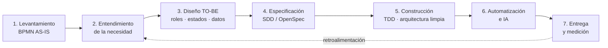

<h1 align="center">Hola 👋, soy Juan Pablo Guzmán</h1>
<h3 align="center">Desarrollador Full Stack · Transformo procesos de negocio en software</h3>

  Antes de escribir código entiendo el proceso. Lo modelo con <b>BPMN</b>, encuentro dónde se pierde tiempo o se cometen errores,
  y después construyo la herramienta que lo resuelve: sistemas web, automatización de datos e IA aplicada.

---

## 🔄 Cómo trabajo

Uso el mismo flujo en todos mis proyectos, desde la primera conversación con el cliente hasta la entrega en producción.

| Etapa | Qué hago | Qué entrego |
|-------|----------|-------------|
| **1. Levantamiento** | Hago sesiones con los dueños del proceso y modelo el flujo actual con swimlanes: actores, entidades externas y decisiones. | Diagrama BPMN AS-IS (draw.io) |
| **2. Entendimiento** | Busco el dolor real: reprocesos, datos aislados, errores de transcripción, falta de trazabilidad. Defino los KPIs que importan. | Alcance, fuera de alcance, indicadores |
| **3. Diseño TO-BE** | Rediseño el proceso con roles, máquinas de estado y puntos de control (*gates*) que el sistema obliga a cumplir. | Flujo objetivo y modelo de datos |
| **4. Especificación** | Convierto el diseño en specs, decisiones técnicas y tareas con Spec-Driven Development. | Propuesta, spec, diseño y tareas |
| **5. Construcción** | Desarrollo con TDD y arquitectura hexagonal/limpia, con seguridad a nivel de fila (RLS) desde el inicio. | Software probado y mantenible |
| **6. Automatización e IA** | Aplico IA donde aporta: agentes conversacionales, OCR de documentos, análisis normativo. Las cifras salen de cálculos deterministas, no del modelo. | Flujos automatizados y auditables |
| **7. Entrega** | Despliego, documento para el usuario final y mido contra los KPIs definidos. | Producción, manuales, métricas |

---

## 🚀 Proyectos recientes

> Varios de estos proyectos son de clientes y sus repositorios son privados. Describo el problema y la solución sin datos confidenciales.

### 🏗️ ERP de estructuración inmobiliaria
**Proceso:** evaluar si un lote puede convertirse en un proyecto viable desde cuatro frentes: comercial, jurídico, arquitectónico y financiero.
- Levanté el proceso en BPMN con el fundador: 5 carriles (comercial, arquitectura, finanzas, administración y entidades externas) y dos modelos de negocio.
- Lo convertí en un ciclo de vida de oportunidades de 8 fases, con compuertas de decisión que la base de datos hace cumplir.
- Cubre propuestas y costeo, presupuesto vs. real, rentabilidad (calculada a partir de horas y gastos), comisiones, nómina y un **agente de WhatsApp con IA** que actúa con los permisos del usuario.
- `Next.js 16` `Supabase` `RLS` `OpenAI` `Arquitectura hexagonal` `Vitest`

### 📊 Dashboard de autorizaciones en salud
**Proceso:** autorizaciones médicas desde la orden del médico hasta la cita atendida, para medir el **% de cumplimiento** por médico, especialidad y regional.
- Modelé el proceso en BPMN con cuatro actores (afiliado, médico, EPS e IPS/auditoría) y anoté cada paso con datos reales.
- Construí un ETL que normaliza 76 columnas de Excel y carga **~6.8M de registros** en PostgreSQL particionado con vistas materializadas.
- Los filtros responden en **menos de 2 s**, el acceso está separado por rol y regional, y los datos se exportan a Excel.
- `Next.js` `Python` `pandas` `PostgreSQL 16` `Docker` `Nginx`

### ☢️ Control de calidad de equipos de rayos X (offline-first)
**Proceso:** pruebas de control de calidad en campo a equipos médicos, odontológicos e industriales, según la Resolución 1811/2023.
- Pasé un proceso hecho en papel y Excel a un flujo con trazabilidad completa: solicitud → visita → pre-informe → revisión → informe aprobado con QR de validación.
- Funciona **sin conexión**: el técnico trabaja la jornada completa y luego sincroniza en ambos sentidos.
- Un motor de reglas evalúa la conformidad y elimina los errores de transcripción. También importa mediciones de equipos de medición.
- `Next.js 16` `React 19` `IndexedDB/Dexie` `Supabase` `Zod` `Vitest`

### 🧾 Gestión de viáticos con OCR
**Proceso:** solicitud, aprobación y legalización de viáticos del personal de campo.
- Usé una máquina de estados con un responsable por etapa y aprobación en varios niveles.
- Los datos de las facturas (NIT, fecha, subtotal e impuestos) se leen con **IA (Gemini)**.
- Incluye reportes PDF/Excel, notificaciones por correo y un log de auditoría inmutable.
- `Next.js 15` `Firebase` `Genkit` `Gemini` `Jest`

### 🏦 Conciliación bancaria automática
**Proceso:** cruzar el extracto bancario con la contabilidad, una tarea que se hacía a mano.
- El cruce funciona por niveles: monto exacto, tolerancia de fechas y montos aproximados. Los cargos bancarios (GMF, comisiones, retenciones) se clasifican solos.
- Genera un reporte Excel con resumen ejecutivo. Pensado para usuarios no técnicos: se ejecuta con doble clic.
- `Python` `pandas` `openpyxl`

### 🧠 Trama: soporte a decisiones con ontologías e IA *(producto propio, en desarrollo)*
**Proceso:** pasar de una pregunta de negocio ("¿por qué esta línea no es rentable?") a una decisión con evidencia.
- Construye un grafo de conocimiento (RDF/OWL) a partir de los datos de la empresa y razona sobre él de forma formal.
- Un agente orquestador coordina subagentes (NL→SPARQL, diseño de dashboards). Ninguna cifra sale del LLM: todas provienen de consultas ejecutadas o simulaciones deterministas.
- Tiene puntos de control humanos (*human-in-the-loop*) y simulación AS-IS / TO-BE del impacto de cada decisión.
- `Next.js 16` `FastAPI` `PostgreSQL` `Anthropic` `OpenAI` `Playwright`

---

## 🛠️ Tecnologías

**Modelado y análisis:** BPMN 2.0 · draw.io · Máquinas de estado · Modelado de datos (DBML)

  
  
  
  
  
  
  
  
  
  
  
  
  
  

**IA:** OpenAI · Anthropic (Claude) · Gemini / Genkit · Agentes y tool-calling · OCR de documentos
**Prácticas:** Arquitectura hexagonal / limpia · TDD · Spec-Driven Development · Offline-first · Seguridad RLS · Ley 1581 (protección de datos)

---

<i>Primero el proceso, después la tecnología.</i>

